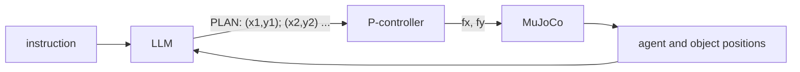

# Context-aware RL agent

[](https://github.com/Sulimowski/Context-aware-RL-agent/actions/workflows/ci.yml)
[](LICENSE)

Experiments with an agent in MuJoCo that gets a text instruction plus the current scene state,
lets a small local LLM (qwen2.5:3b through Ollama) reason about it, and turns the answer into
low-level control. Right now the agent is a cube in a walled arena; the plan is to train an RL
policy conditioned on this context and later move to the OpenArm robot.


The orange cube is the agent, the blue cube is a passive object it can push, the green pad is the
target, and the colored spheres mark the corners.

## Contents

| Script | Description |
|---|---|
| [`test1/play.py`](test1/play.py) | Drive the cube from the keyboard to check the physics and the action space |
| [`test1/llm_control.py`](test1/llm_control.py) | The LLM reasons step by step and outputs a force `FORCE: fx, fy` every ~0.4 s |
| [`test1/llm_drive.py`](test1/llm_drive.py) | You type an instruction, the LLM answers with a list of waypoints, a P-controller follows them |
| [`view.py`](view.py) | Viewer and pose editor for the OpenArm bimanual robot |
| [`gpu_check.py`](gpu_check.py) | Prints which GPU the OpenGL context uses and whether PyTorch sees CUDA |

## How it works

Physics and rendering run at 60 fps in the main thread. The LLM is queried in a separate thread,
so the simulation keeps going while the model is thinking.

`llm_drive.py`:



`llm_control.py` works in a closed loop: on every step the prompt contains the cube position, the
target, and the previous action with the distance it led to. If the distance grew, the model can
see that it pushed the wrong way and correct itself.

## Setup

Python 3.11. For the LLM scripts you also need [Ollama](https://ollama.com/).

```bash
git clone https://github.com/Sulimowski/Context-aware-RL-agent.git
cd Context-aware-RL-agent
python -m venv .venv
.venv\Scripts\activate          # on Linux/macOS: source .venv/bin/activate
pip install -r requirements.txt
ollama pull qwen2.5:3b
```

The scripts expect Ollama at `http://localhost:11434`. To use a different model, change `MODEL`
at the top of the script.

`view.py` needs the OpenArm models, which are not included in this repo:

```bash
git clone https://github.com/enactic/openarm_mujoco.git
```

## Usage

Run everything from the repository root.

### test1/play.py

| Key | Action |
|---|---|
| W A S D / arrows | change the force along +y / -x / -y / +x |
| Space | set the force to zero |
| T | random new target near one of the walls |
| R | reset |

### test1/llm_control.py

Opens the viewer and the LLM drives the cube to the target pad. Each decision is printed to the
console with the cube position, distance, chosen force and response time. The prompt is in
`ask_llm()`.

### test1/llm_drive.py

Needs a terminal with keyboard input. Examples of instructions:

```text
go to the blue cube
visit all the corners
go to the center, then to the bottom-right corner
```

The model's reasoning is streamed to the console, then the parsed plan is printed. The green
marker shows the current waypoint. An empty line or `quit` exits.

### view.py

```bash
python view.py                # bimanual (v1/scene.xml)
python view.py single         # single arm
python view.py path/to.xml    # any model
```


Space toggles between pause mode (joint angles are set directly, no dynamics) and physics mode
(a PD controller holds the pose).

| Key | Action |
|---|---|
| 1-9, `,` `.` | select a joint |
| `[` `]` | decrease / increase the joint angle |
| O / C | open / close the grippers |
| arrows, W/S, A/D, Q/E | camera orbit, zoom, pan |
| R | reset pose and camera |

## Arena

[`test1/arena.xml`](test1/arena.xml): 0.8 x 0.8 m field with 6 cm walls. The agent is a 5 cm cube
(0.2 kg) on two slide joints, so it stays in the plane and can't tip over. It is driven by two
motors `fx`, `fy` with `ctrl` in [-1, 1]. The blue cube is the same size but has no motors.
Timestep is 5 ms. Coordinates used in the prompts: +x is right, +y is forward.

## Tests

```bash
pip install pytest
python -m pytest tests
```

The tests check that the arena loads, that the motors move the cube in the right directions,
that the walls keep it inside, and that the LLM answer parsers work.

## TODO

- [ ] Gymnasium wrapper with rewards for the arena tasks
- [ ] RL policy (PPO) conditioned on the instruction / LLM plan
- [ ] Pushing the blue cube to a given point
- [ ] Moving from the cube to OpenArm

## Credits

- [MuJoCo](https://github.com/google-deepmind/mujoco)
- [OpenArm MuJoCo models](https://github.com/enactic/openarm_mujoco) by Enactic (Apache-2.0)
- [Qwen2.5](https://github.com/QwenLM/Qwen2.5), run with [Ollama](https://ollama.com/)

## License

[MIT](LICENSE)
