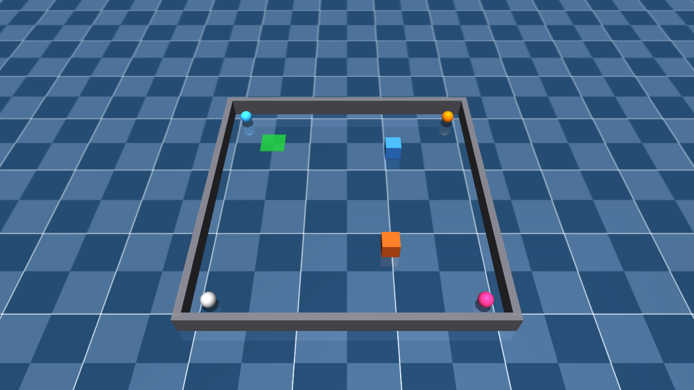
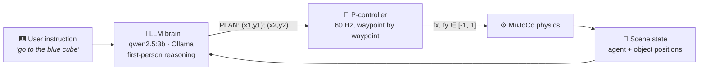
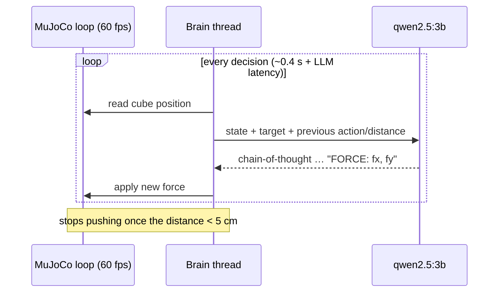
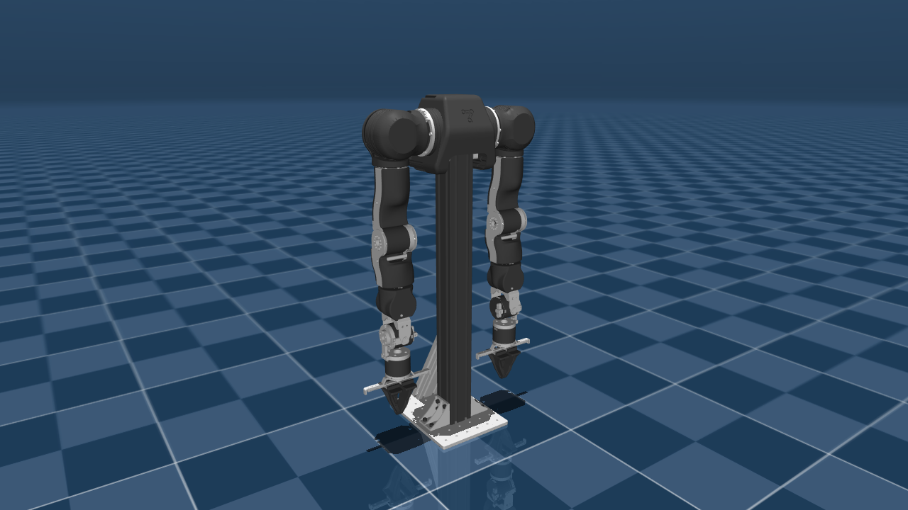

<div align="center">

# 🧠 Context-aware RL Agent

**An embodied agent sandbox in MuJoCo where a local LLM reads the scene and a natural-language
instruction, reasons about it, and hands a plan to a low-level controller —
the groundwork for a context-conditioned reinforcement-learning policy.**

[](https://github.com/Sulimowski/Context-aware-RL-agent/actions/workflows/ci.yml)
[](https://www.python.org/)
[](https://mujoco.org/)
[](https://ollama.com/library/qwen2.5)
[](LICENSE)



</div>

---

## ✨ Overview

The long-term goal is an agent that understands **context** — *what* it is asked to do and *what* is
around it — instead of optimizing a single hard-coded reward. The project is built up step by step:

| Stage | Script | What it does |
|:---:|---|---|
| 🎮 | [`test1/play.py`](test1/play.py) | Drive the cube by hand — sanity-check of the physics and the action space |
| 🤖 | [`test1/llm_control.py`](test1/llm_control.py) | Closed loop: the LLM reasons step by step and outputs a force `FORCE: fx, fy` every ~0.4 s |
| 💬 | [`test1/llm_drive.py`](test1/llm_drive.py) | Type an instruction in plain text; the cube reasons **in the first person** and returns a **waypoint plan** |
| 🦾 | [`view.py`](view.py) | Pose editor / viewer for the [OpenArm](https://github.com/enactic/openarm_mujoco) bimanual robot — the next embodiment |
| 🖥️ | [`gpu_check.py`](gpu_check.py) | Shows which GPU the OpenGL context really uses and whether CUDA is visible to PyTorch |

## 🧩 How it works

### Instruction → plan → control (`llm_drive.py`)

The slow, smart part (the LLM) and the fast, dumb part (the controller) run at different rates
in separate threads, so the simulation never waits for the model.



### Step-by-step closed loop (`llm_control.py`)



Feeding the previous action and the previous distance back into the prompt lets the model notice
when it pushed the wrong way and correct itself — a tiny form of in-context feedback.

## 🚀 Quick start

### 1. Prerequisites

- **Python 3.11** (the version the project is developed and tested with)
- **[Ollama](https://ollama.com/)** — only for the LLM demos
- A GPU with OpenGL for the interactive viewer (tested on Windows 11)

### 2. Install

```bash
git clone https://github.com/Sulimowski/Context-aware-RL-agent.git
cd Context-aware-RL-agent
python -m venv .venv
.venv\Scripts\activate          # Windows
# source .venv/bin/activate     # Linux / macOS
pip install -r requirements.txt
```

### 3. Pull the LLM (for `llm_control.py` / `llm_drive.py`)

```bash
ollama pull qwen2.5:3b
```

The scripts talk to Ollama at `http://localhost:11434`. Any other Ollama model can be used by
changing the `MODEL` constant at the top of the script.

### 4. (Optional) OpenArm models for `view.py`

The robot models are not part of this repository — clone them next to the scripts:

```bash
git clone https://github.com/enactic/openarm_mujoco.git
```

## 🕹️ Usage

All commands are run from the repository root.

<details open>
<summary><b>🎮 Manual control — <code>python test1/play.py</code></b></summary>

| Key | Action |
|---|---|
| `W` `A` `S` `D` / arrows | Add force along `+y` / `−x` / `−y` / `+x` |
| `Space` | Zero the force |
| `T` | New random target at one of the edges |
| `R` | Reset the simulation |
| Mouse | Camera |

</details>

<details>
<summary><b>🤖 LLM closed loop — <code>python test1/llm_control.py</code></b></summary>

Opens the viewer and lets the LLM steer the cube to the green target pad. Every decision is printed,
for example:

```text
cube=(+0.00,+0.00) dist=0.350 → LLM fx=+1.00 fy=+0.00 (812 ms)
...
✅ REACHED! distance 0.046
```

The prompt lives in `ask_llm()` between the `HERE IS THE PROMPT` markers.

</details>

<details>
<summary><b>💬 Text-driven planning — <code>python test1/llm_drive.py</code></b></summary>

Run it in a regular terminal (it reads keyboard input), then type instructions such as:

- `go to the blue cube`
- `visit all the corners`
- `go to the center, then to the bottom-right corner`

The model's reasoning is streamed live, the parsed plan is printed, and the green marker shows the
current waypoint. An empty line or `quit` exits.

</details>

<details>
<summary><b>🦾 OpenArm viewer / pose editor — <code>python view.py [single | path.xml]</code></b></summary>



Two modes, toggled with `Space`: **PAUSE** (kinematic posing, nothing falls) and **PHYSICS**
(real dynamics with a PD controller holding the pose).

| Key | Action |
|---|---|
| `1`…`9` | Select a joint |
| `,` / `.` | Cycle through all joints |
| `[` / `]` | Decrease / increase the selected joint angle |
| `O` / `C` | Open / close all grippers |
| `←` `→` / `↑` `↓` | Orbit / tilt the camera |
| `W` / `S` | Zoom in / out |
| `A` `D` / `Q` `E` | Pan the look-at point horizontally / vertically |
| `R` | Reset pose and camera |

</details>

## 🗺️ The arena

Defined in [`test1/arena.xml`](test1/arena.xml):

| Element | Details |
|---|---|
| Field | 0.8 × 0.8 m, enclosed by 6 cm walls (inner face at ±0.4 m) |
| Agent | Orange 5 cm cube, 0.2 kg, planar `slide-x` / `slide-y` joints — cannot tip over |
| Object | Blue 5 cm cube — passive and pushable, no motors |
| Actions | Two motors `fx`, `fy`, `ctrl ∈ [-1, 1]`, gear 3 |
| Target | Semi-transparent green pad, moved from Python |
| Landmarks | Corner spheres `RIGHT_UP`, `LEFT_UP`, `LEFT_DOWN`, `RIGHT_DOWN` (`+x` right, `+y` forward) |
| Timestep | 5 ms |

## 📁 Project structure

```text
Context-aware-RL-agent/
├── test1/
│   ├── arena.xml          # MuJoCo scene: field, walls, agent cube, object cube, target
│   ├── play.py            # manual keyboard control
│   ├── llm_control.py     # LLM → force, chain-of-thought closed loop
│   └── llm_drive.py       # text instruction → LLM waypoint plan → P-controller
├── tests/
│   └── test_smoke.py      # physics + parser smoke tests (run in CI)
├── docs/images/           # README renders
├── view.py                # OpenArm viewer / pose editor
├── gpu_check.py           # OpenGL renderer + CUDA check
└── requirements.txt
```

## 🛣️ Roadmap

- [x] Cube arena with a pushable object, target pad and labeled corners
- [x] LLM closed-loop control with chain-of-thought and in-context feedback
- [x] Natural-language instruction → first-person reasoning → waypoint plan
- [x] OpenArm bimanual viewer and pose editor
- [ ] Gymnasium environment wrapper with a reward for the arena tasks
- [ ] RL policy (e.g. PPO) conditioned on an encoded instruction / LLM plan
- [ ] Object manipulation tasks: push the blue cube to a given location
- [ ] Transfer from the cube to the OpenArm robot

## 🙏 Acknowledgements

- [MuJoCo](https://github.com/google-deepmind/mujoco) — physics engine by Google DeepMind
- [OpenArm MJCF models](https://github.com/enactic/openarm_mujoco) by Enactic (Apache-2.0)
- [Qwen2.5](https://github.com/QwenLM/Qwen2.5) served locally with [Ollama](https://ollama.com/)

## 📄 License

Released under the [MIT License](LICENSE).
